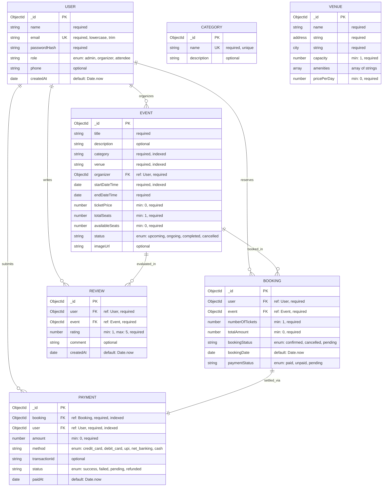

# EventHub — Full-Stack Campus Event & Ticket Management System

[](#academic-submission-details)
[-green.svg)](#tech-stack)
[](#database-schema--relational-normalization)
[](#1-acid-transactions--concurrency-control)
[](#3-role-based-access-control-rbac)
[](#license)

---

## Academic Submission Details

| Field | Details |
| :--- | :--- |
| **Student Name** | **Pratham Tiwari** |
| **University UID** | **24BCS11185** |
| **Course** | **Database Management Systems (DBMS) — 5th Semester Lab Project** |
| **Academic Term** | 5th Semester |
| **Project Repository** | [EventHub — Campus Event Management](https://github.com/) |

---

## Table of Contents
- [Project Overview](#project-overview)
- [Key Features](#key-features)
- [Tech Stack](#tech-stack)
- [Database Schema & Relational Normalization](#database-schema--relational-normalization)
  - [Entity-Relationship (ER) Diagram](#entity-relationship-er-diagram)
  - [Collection Schema Specifications](#collection-schema-specifications)
  - [Relational Normalization & Design Analysis](#relational-normalization--design-analysis)
- [Core DBMS Concepts Implemented](#core-dbms-concepts-implemented)
  - [1. ACID Transactions & Concurrency Control](#1-acid-transactions--concurrency-control)
  - [2. Indexing & Query Optimization](#2-indexing--query-optimization)
  - [3. Role-Based Access Control (RBAC)](#3-role-based-access-control-rbac)
- [REST API Endpoints Summary](#rest-api-endpoints-summary)
- [Project Directory Structure](#project-directory-structure)
- [Local Setup & Installation Guide](#local-setup--installation-guide)
  - [Prerequisites](#prerequisites)
  - [Step 1: Clone Repository](#step-1-clone-repository)
  - [Step 2: Environment Configuration](#step-2-environment-configuration)
  - [Step 3: One-Step Dependency Installation](#step-3-one-step-dependency-installation)
  - [Step 4: Run Application Concurrently](#step-4-run-application-concurrently)
- [Verification & Testing](#verification--testing)
- [License](#license)

---

## Project Overview

**EventHub** is an enterprise-grade full-stack campus event discovery, ticket reservation, and administrative event management platform engineered specifically for university ecosystems. Designed to simulate real-world high-concurrency booking demands (such as campus festivals, hackathons, guest lectures, and cultural nights), EventHub demonstrates core Database Management Systems (DBMS) principles inside a modern Document-Relational architecture.

While built on MongoDB Atlas, the system rigorously enforces relational integrity, foreign key references, compound uniqueness constraints, and **ACID multi-document transactional guarantees** to eliminate race conditions and seat overbooking during simultaneous attendee checkouts.

---

## Key Features

- **High-Concurrency Seat Locking:** Guarantees zero seat overselling using MongoDB two-phase commit multi-document transactions with snapshot isolation.
- **Dynamic Role-Based Access Control (RBAC):** Three distinct authorization levels (`attendee`, `organizer`, `admin`) with layered route guards and resource ownership verification.
- **Relational Referencing in NoSQL:** Normalized schemas utilizing Mongoose population for parent-child relations across Users, Events, Bookings, Payments, and Reviews.
- **Real-Time Inventory Updates:** Live deduction and instant restock upon booking cancellations.
- **Auditing & Payment Tracking:** Atomic recording of payment receipts linked to bookings with support for multiple payment channels (UPI, Cards, Net Banking, Cash).
- **Social Proof & Rating Integrity:** 1-to-5 star event reviews guarded by compound unique indexes preventing review duplication per user.

---

## Tech Stack

The system is developed using modern web standards with strict separation of concerns across the presentation, logic, and persistence tiers:

```
┌─────────────────────────────────────────────────────────────┐
│                       CLIENT TIER                           │
│  React 18  │  Vite  │  Tailwind CSS  │  React Router DOM    │
│             Axios HTTP Client  │  Lucide React              │
└──────────────────────────────┬──────────────────────────────┘
                               │ JSON REST API (Proxy: /api)
┌──────────────────────────────▼──────────────────────────────┐
│                       SERVER TIER                           │
│  Node.js Runtime  │  Express.js REST Framework               │
│  JWT Authentication  │  Bcrypt Hashing  │  Express-Validator │
└──────────────────────────────┬──────────────────────────────┘
                               │ Mongoose ODM (Sessions / Hooks)
┌──────────────────────────────▼──────────────────────────────┐
│                      DATABASE TIER                          │
│  MongoDB Atlas Cluster (Replica Set)                        │
│  ACID Multi-Document Transactions  │  Compound B-Tree Index │
└─────────────────────────────────────────────────────────────┘
```

### Exact Technology Versions Found in Codebase

| Technology | Category | Role in System |
| :--- | :--- | :--- |
| **React 18** (`^18.3.1`) | Frontend Library | Component-driven UI rendering, state management, and real-time form bindings |
| **Vite** (`^5.4.14`) | Build Tool / Bundler | Ultra-fast HMR dev server and optimized production assets bundler |
| **Tailwind CSS** (`^3.4.17`) | UI Styling Engine | Utility-first responsive design system with custom theme tokens |
| **React Router DOM** (`^6.28.2`) | Client Routing | Declarative client-side routing with protected route authorization wrappers |
| **Axios** (`^1.7.9`) | HTTP Client | Promise-based asynchronous communication with interceptors and JWT authorization headers |
| **Lucide React** (`^0.475.0`) | Iconography | High-performance vector UI icons |
| **Node.js** | Backend Runtime | Non-blocking, event-driven JavaScript server runtime |
| **Express.js** (`^4.19.2`) | Backend Framework | REST API micro-routing, middleware pipeline, and centralized error handling |
| **MongoDB Atlas** | Database | Cloud distributed document database cluster operating as a replica set |
| **Mongoose ODM** (`^8.4.0`) | Database Modeling | Schema enforcement, validation rules, relational population, and session transactions |
| **JWT** (`^9.0.2`) | Authentication | Stateless authentication using cryptographically signed JSON Web Tokens |
| **Bcrypt** (`^5.1.0`) | Cryptography | One-way salted password hashing (10 salt rounds) |
| **Express-Validator** (`^7.0.1`) | Input Validation | Server-side request body and query parameter sanitization & validation |
| **Concurrently** (`^8.2.2`) | Process Orchestration | Simultaneous execution of client and server processes in single dev command |

---

## Database Schema & Relational Normalization

### Entity-Relationship (ER) Diagram

The following Mermaid ER diagram illustrates the relational mapping between the 7 collections in EventHub:



---

### Collection Schema Specifications

All models are defined under `server/models/` with strict schema validation:

#### 1. Users Collection (`server/models/User.js`)
Stores authentication identities, encrypted credentials, contact metadata, and authorization roles.

| Field Name | Data Type | Constraints / Modifiers | Foreign Key Ref | Description |
| :--- | :--- | :--- | :--- | :--- |
| `_id` | `ObjectId` | Primary Key, Auto-generated | — | Unique user identifier |
| `name` | `String` | `required: true` | — | User's full name |
| `email` | `String` | `required: true`, `unique: true`, `lowercase: true`, `trim: true` | — | Unique login email address |
| `passwordHash` | `String` | `required: true` | — | Salted hash generated via `bcrypt` |
| `role` | `String` | `enum: ['admin', 'organizer', 'attendee']`, `default: 'attendee'` | — | System access control level |
| `phone` | `String` | `required: false` | — | Contact telephone number |
| `createdAt` | `Date` | `default: Date.now` | — | Timestamp of account registration |

#### 2. Events Collection (`server/models/Event.js`)
Represents campus gatherings, schedules, ticketing constraints, and available seat inventory.

| Field Name | Data Type | Constraints / Modifiers | Foreign Key Ref | Description |
| :--- | :--- | :--- | :--- | :--- |
| `_id` | `ObjectId` | Primary Key, Auto-generated | — | Unique event identifier |
| `title` | `String` | `required: true` | — | Event headline / name |
| `description` | `String` | `required: false` | — | Detailed overview of the event |
| `category` | `String` | `required: true`, Indexed | — | Event classification category |
| `venue` | `String` | `required: true`, Indexed | — | Physical hall or auditorium name |
| `organizer` | `ObjectId` | `required: true` | `User._id` | Foreign Key to the creating user |
| `startDateTime` | `Date` | `required: true`, Indexed | — | Event commencement date & time |
| `endDateTime` | `Date` | `required: true` | — | Event conclusion date & time |
| `ticketPrice` | `Number` | `required: true`, `min: 0` | — | Cost per ticket (0 = Free event) |
| `totalSeats` | `Number` | `required: true`, `min: 1` | — | Total seat capacity of venue |
| `availableSeats` | `Number` | `required: true`, `min: 0` | — | Real-time remaining unbooked seats |
| `status` | `String` | `enum: ['upcoming','ongoing','completed','cancelled']`, `default: 'upcoming'` | — | Event lifecycle status |
| `imageUrl` | `String` | `required: false` | — | Cover banner URL |

#### 3. Bookings Collection (`server/models/Booking.js`)
Tracks seat reservations placed by attendees for specific events.

| Field Name | Data Type | Constraints / Modifiers | Foreign Key Ref | Description |
| :--- | :--- | :--- | :--- | :--- |
| `_id` | `ObjectId` | Primary Key, Auto-generated | — | Unique reservation code / identifier |
| `user` | `ObjectId` | `required: true` | `User._id` | Attendee who placed reservation |
| `event` | `ObjectId` | `required: true` | `Event._id` | Target event being reserved |
| `numberOfTickets` | `Number` | `required: true`, `min: 1` | — | Count of tickets requested |
| `totalAmount` | `Number` | `required: true`, `min: 0` | — | Computed cost (`tickets * price`) |
| `bookingStatus` | `String` | `enum: ['confirmed','cancelled','pending']`, `default: 'pending'` | — | Status of reservation lifecycle |
| `bookingDate` | `Date` | `default: Date.now` | — | Timestamp when booking was submitted |
| `paymentStatus` | `String` | `enum: ['paid','unpaid','pending']`, `default: 'pending'` | — | Payment settlement flag |

#### 4. Payments Collection (`server/models/Payment.js`)
Financial ledger recording transaction receipts tied to bookings.

| Field Name | Data Type | Constraints / Modifiers | Foreign Key Ref | Description |
| :--- | :--- | :--- | :--- | :--- |
| `_id` | `ObjectId` | Primary Key, Auto-generated | — | Unique payment transaction ID |
| `booking` | `ObjectId` | `required: true`, Indexed | `Booking._id` | Target booking settled by payment |
| `user` | `ObjectId` | `required: true`, Indexed | `User._id` | User submitting payment |
| `amount` | `Number` | `required: true`, `min: 0` | — | Exact amount paid |
| `method` | `String` | `enum: ['credit_card','debit_card','upi','net_banking','cash']`, `default: 'credit_card'` | — | Payment channel used |
| `transactionId` | `String` | `required: false` | — | External gateway transaction hash |
| `status` | `String` | `enum: ['success','failed','pending','refunded']`, `default: 'pending'` | — | Gateway settlement status |
| `paidAt` | `Date` | `default: Date.now` | — | Timestamp of payment execution |

#### 5. Reviews Collection (`server/models/Review.js`)
Attendee feedback and 5-star ratings for attended events.

| Field Name | Data Type | Constraints / Modifiers | Foreign Key Ref | Description |
| :--- | :--- | :--- | :--- | :--- |
| `_id` | `ObjectId` | Primary Key, Auto-generated | — | Unique review record ID |
| `user` | `ObjectId` | `required: true` | `User._id` | Review author |
| `event` | `ObjectId` | `required: true` | `Event._id` | Target event reviewed |
| `rating` | `Number` | `required: true`, `min: 1`, `max: 5` | — | 1 to 5 star rating score |
| `comment` | `String` | `required: false` | — | Textual feedback |
| `createdAt` | `Date` | `default: Date.now` | — | Timestamp review was published |

#### 6. Categories Collection (`server/models/Category.js`)
Taxonomy catalog for categorizing campus events (e.g., Workshops, Cultural, Sports, Tech).

| Field Name | Data Type | Constraints / Modifiers | Foreign Key Ref | Description |
| :--- | :--- | :--- | :--- | :--- |
| `_id` | `ObjectId` | Primary Key, Auto-generated | — | Unique category ID |
| `name` | `String` | `required: true`, `unique: true` | — | Unique category classification name |
| `description` | `String` | `required: false` | — | Detailed description of category |

#### 7. Venues Collection (`server/models/Venue.js`)
Campus halls, auditoriums, and open grounds available for hosting events.

| Field Name | Data Type | Constraints / Modifiers | Foreign Key Ref | Description |
| :--- | :--- | :--- | :--- | :--- |
| `_id` | `ObjectId` | Primary Key, Auto-generated | — | Unique venue identifier |
| `name` | `String` | `required: true` | — | Name of hall / auditorium |
| `address` | `String` | `required: true` | — | Campus block / street address |
| `city` | `String` | `required: true` | — | City / campus location |
| `capacity` | `Number` | `required: true`, `min: 1` | — | Maximum seating capacity |
| `amenities` | `[String]` | Array of Strings | — | List of available facilities |
| `pricePerDay` | `Number` | `required: true`, `min: 0` | — | Daily rental charge |

---

### Relational Normalization & Design Analysis

In enterprise DBMS engineering, database normalization organizes schemas to minimize data redundancy and avoid modification anomalies (insertion, update, and deletion anomalies):

1. **First Normal Form (1NF):**
   - Each collection contains atomic values (no multivalued or composite non-scalar records).
   - Each document is uniquely identified by an immutable Primary Key (`_id`).
   - Although `Venue.amenities` uses an embedded array, it represents homogeneous attribute sets rather than relational entities.

2. **Second Normal Form (2NF):**
   - The schemas satisfy 1NF, and all non-key attributes are fully functionally dependent on the primary key `_id`.
   - In composite scenarios (e.g., Bookings connecting a User and an Event), attributes such as `numberOfTickets` and `totalAmount` depend strictly on the reservation entity `_id`, not partially on the User or Event alone.

3. **Third Normal Form (3NF):**
   - No transitive dependencies exist across non-prime attributes.
   - For example, `Booking` does not duplicate the `Event.ticketPrice`, `User.email`, or `User.name`. Instead, it stores `user: ObjectId` and `event: ObjectId` references. When full details are needed, Mongoose `.populate()` joins documents dynamically at query time, completely eliminating update anomalies.

4. **Strategic Referencing vs. Embedding (DBMS Trade-Off):**
   - **Referencing (Normalized):** Adopted for `Bookings`, `Payments`, and `Reviews` because these entities grow unboundedly and require isolated locks inside multi-document transactions.
   - **Embedding (Denormalized):** Restricted to small, static lists like `Venue.amenities` where array updates are localized and do not require transactional joins.

---

## Core DBMS Concepts Implemented

### 1. ACID Transactions & Concurrency Control

In high-concurrency ticket reservations, multiple attendees simultaneously attempting to book the last available seat leads to race conditions, leading to **dirty reads** and **overbooking**.

EventHub implements **ACID Multi-Document Transactions** using Mongoose Sessions and MongoDB Replica Sets.

#### Exact Code Citation
- **File:** `server/controllers/bookingController.js`
- **Route:** `POST /api/bookings` (Invoking `createBooking`) & `PATCH /api/bookings/:id/cancel` (Invoking `cancelBooking`)

```javascript
// Citation: server/controllers/bookingController.js (Lines 41 - 81)
exports.createBooking = async (req, res, next) => {
  // 1. Initialize session and start multi-document ACID transaction
  const session = await mongoose.startSession();
  session.startTransaction();
  try {
    const { eventId, numberOfTickets } = req.body;

    // 2. Read event within transactional snapshot
    const event = await Event.findById(eventId).session(session);
    if (!event) {
      await session.abortTransaction();
      return res.status(404).json({ message: 'Event not found' });
    }

    // 3. Concurrency check: Ensure available seats satisfy requested tickets
    if (event.availableSeats < numberOfTickets) {
      await session.abortTransaction(); // Abort before state corruption
      return res.status(400).json({ message: 'Not enough seats available' });
    }

    // 4. Atomically decrement available seats in database
    event.availableSeats -= numberOfTickets;
    await event.save({ session });

    // 5. Create confirmed booking record within the exact same session
    const booking = await Booking.create(
      [
        {
          user: req.user.id,
          event: eventId,
          numberOfTickets,
          totalAmount: numberOfTickets * event.ticketPrice,
          bookingStatus: 'confirmed'
        }
      ],
      { session }
    );

    // 6. Commit all operations simultaneously (Atomicity & Durability)
    await session.commitTransaction();
    res.status(201).json(booking[0]);
  } catch (err) {
    // 7. Rollback all modified documents if any step fails
    await session.abortTransaction();
    next(err);
  } finally {
    // 8. Always terminate session to prevent resource leakage
    session.endSession();
  }
};
```

#### How ACID Guarantees Are Enforced:
- **Atomicity:** Both `event.availableSeats` reduction and `Booking.create()` occur together. If either crashes or validation fails, `session.abortTransaction()` reverts both operations.
- **Consistency:** The constraint `availableSeats >= numberOfTickets` is enforced before saving; the database never transitions into an invalid state where `availableSeats < 0`.
- **Isolation:** Snapshot isolation prevents other concurrent booking requests from reading uncommitted seat deductions.
- **Durability:** Upon `session.commitTransaction()`, the changes are written to the MongoDB write-ahead journal and replicated across the cluster.

---

### 2. Indexing & Query Optimization

To transform linear collection scans (`COLLSCAN`) with time complexity $\mathcal{O}(N)$ into logarithmic index scans (`IXSCAN`) with time complexity $\mathcal{O}(\log N)$, custom B-Tree indexes are declared across schemas:

| Collection | Indexed Field(s) | Index Type | Purpose / Query Optimization |
| :--- | :--- | :--- | :--- |
| **User** | `{ email: 1 }` | **Unique Single-Field** | Enforces email uniqueness and provides $\mathcal{O}(1)$ lookup during login (`User.findOne({ email })`). |
| **Event** | `{ startDateTime: 1 }` | **Single-Field (Ascending)** | Accelerates chronology filtering, sorting upcoming events, and calendar views. |
| **Event** | `{ category: 1 }` | **Single-Field** | Optimizes category-based event discovery and filtering dropdowns. |
| **Event** | `{ venue: 1 }` | **Single-Field** | Speeds up venue conflict checks and location-based searches. |
| **Booking** | `{ user: 1, event: 1 }` | **Compound Index** | Optimizes attendee booking lookups (`Booking.find({ user, event })`) and prevents indexing overhead on individual fields. |
| **Payment** | `{ booking: 1 }` | **Single-Field** | Enables instant lookups of payment receipts linked to a booking ID. |
| **Payment** | `{ user: 1 }` | **Single-Field** | Accelerates attendee billing history retrieval (`/api/payments/mine`). |
| **Review** | `{ user: 1, event: 1 }` | **Compound Unique Index** | **Data Integrity Rule:** Enforces that an attendee can submit **at most one review per event** while accelerating event review retrieval. |
| **Category**| `{ name: 1 }` | **Unique Single-Field** | Guarantees uniqueness for taxonomy categories (`unique: true`). |

---

### 3. Role-Based Access Control (RBAC)

EventHub enforces a strict principle of least privilege using modular middleware pipelines:

```
Incoming Request
      │
      ▼
[ protect ] ─────────► Verifies JWT in Bearer Authorization Header
      │               Populates req.user = { id, role }
      ▼
[ role(['admin', ...]) ] ──► Checks if req.user.role is authorized
      │
      ├─── Yes ──────► Passes to Controller Handler
      └─── No  ──────► Emits HTTP 403 Forbidden ("Access denied")
```

#### Middleware Implementation
1. **`server/middleware/auth.js` (`protect`):**
   Extracts and decodes the signed JWT from the `Authorization: Bearer <token>` header, verifying its signature against `process.env.JWT_SECRET` and attaching `req.user = decoded` to the request lifecycle.
2. **`server/middleware/role.js` (`role(allowedRoles)`):**
   Higher-order closure evaluating `allowedRoles.includes(req.user.role)`. If unauthorized, it terminates the request immediately with `HTTP 403 Forbidden`.
3. **Controller-Level Ownership Verification:**
   In addition to route guards, controllers verify resource ownership. For instance, in `eventController.js` and `bookingController.js`:
   ```javascript
   if (event.organizer.toString() !== req.user.id && req.user.role !== 'admin') {
     return res.status(403).json({ message: 'Not authorized to modify this resource' });
   }
   ```

#### RBAC Permissions Matrix

| Platform Feature | Attendee | Organizer | Admin |
| :--- | :---: | :---: | :---: |
| Browse Events, Venues & Categories | ✅ | ✅ | ✅ |
| Register Account / Login | ✅ | ✅ | ✅ |
| Book Event Tickets (ACID Transaction) | ✅ | ✅ | ✅ |
| Cancel Own Booking & Release Seats | ✅ | ✅ | ✅ |
| Submit & Manage Own Reviews | ✅ | ✅ | ✅ |
| Create New Events & Set Ticket Capacity | ❌ | ✅ | ✅ |
| Update / Delete Own Events | ❌ | ✅ (Own Only) | ✅ (Any Event) |
| Create Venues | ❌ | ✅ | ✅ |
| Update / Delete Venues | ❌ | ✅ (Update Only) | ✅ (Full CRUD) |
| Manage System Categories (Create/Edit/Delete) | ❌ | ❌ | ✅ |
| View All System Users & Delete Accounts | ❌ | ❌ | ✅ |
| View Global Bookings & System-Wide Financial Ledger | ❌ | ❌ | ✅ |

---

## REST API Endpoints Summary

All routes are mounted under `/api` in `server/index.js` and protected via JWT + Express-Validator.

### Authentication Routes (`/api/auth`)
| Method | Endpoint | Access Level | Description |
| :--- | :--- | :--- | :--- |
| `POST` | `/api/auth/register` | Public | Registers a new account with validated name, email, password, and role |
| `POST` | `/api/auth/login` | Public | Authenticates credentials and returns signed JWT token + user profile |
| `GET` | `/api/auth/me` | Protected (Any Role) | Returns current authenticated user record (excluding password hash) |

### Users Management Routes (`/api/users`)
| Method | Endpoint | Access Level | Description |
| :--- | :--- | :--- | :--- |
| `GET` | `/api/users` | Admin | Fetches all registered users in system |
| `GET` | `/api/users/:id` | Admin, Organizer | Retrieves specific user profile by ObjectId |
| `PUT` | `/api/users/:id` | Admin, Organizer | Updates user profile fields (name, phone) |
| `DELETE` | `/api/users/:id` | Admin | Permanently deletes a user account |

### Events Routes (`/api/events`)
| Method | Endpoint | Access Level | Description |
| :--- | :--- | :--- | :--- |
| `GET` | `/api/events` | Public | Returns all events with populated organizer details |
| `GET` | `/api/events/:id` | Public | Returns detailed information for a single event |
| `POST` | `/api/events` | Admin, Organizer | Creates a new event with total and available seats |
| `PUT` | `/api/events/:id` | Admin, Organizer (Owner) | Updates event details (title, dates, pricing, capacity) |
| `DELETE` | `/api/events/:id` | Admin, Organizer (Owner) | Deletes event from system |

### Bookings Routes (`/api/bookings`)
| Method | Endpoint | Access Level | Description |
| :--- | :--- | :--- | :--- |
| `GET` | `/api/bookings` | Admin | Retrieves all bookings across the university system |
| `GET` | `/api/bookings/mine` | Protected (Any Role) | Fetches chronological booking history for logged-in user |
| `GET` | `/api/bookings/:id` | Protected (Any Role) | Retrieves detailed receipt for specific booking ID |
| `POST` | `/api/bookings` | Protected (Any Role) | **Atomic Seat Booking:** Executes ACID transaction session |
| `PATCH`| `/api/bookings/:id/cancel` | Protected (Owner/Admin) | **Atomic Cancellation:** Restores seats to event inventory |

### Payments Routes (`/api/payments`)
| Method | Endpoint | Access Level | Description |
| :--- | :--- | :--- | :--- |
| `GET` | `/api/payments` | Admin | Audits system-wide transaction records and payment states |
| `GET` | `/api/payments/mine` | Protected (Any Role) | Retrieves personal payment history for authenticated user |
| `GET` | `/api/payments/:id` | Protected (Any Role) | Fetches specific transaction receipt |
| `POST` | `/api/payments` | Protected (Any Role) | Records payment receipt and sets booking `paymentStatus = 'paid'` |

### Reviews Routes (`/api/reviews`)
| Method | Endpoint | Access Level | Description |
| :--- | :--- | :--- | :--- |
| `GET` | `/api/reviews/event/:eventId` | Public | Retrieves all ratings and reviews for an event |
| `POST` | `/api/reviews` | Protected (Any Role) | Submits 1-5 star review (enforces 1 review per user/event) |
| `PUT` | `/api/reviews/:id` | Protected (Owner/Admin) | Updates rating score or comment |
| `DELETE` | `/api/reviews/:id` | Protected (Owner/Admin) | Deletes review record |

### Venues Routes (`/api/venues`)
| Method | Endpoint | Access Level | Description |
| :--- | :--- | :--- | :--- |
| `GET` | `/api/venues` | Public | Lists all campus venues, addresses, and capacities |
| `GET` | `/api/venues/:id` | Public | Fetches detailed venue profile and amenities |
| `POST` | `/api/venues` | Admin, Organizer | Creates and registers a new venue facility |
| `PUT` | `/api/venues/:id` | Admin, Organizer | Updates venue capacity, amenities, or pricing |
| `DELETE` | `/api/venues/:id` | Admin | Deletes venue from database |

### Categories Routes (`/api/categories`)
| Method | Endpoint | Access Level | Description |
| :--- | :--- | :--- | :--- |
| `GET` | `/api/categories` | Public | Lists all event categories |
| `GET` | `/api/categories/:id` | Public | Gets specific category by ID |
| `POST` | `/api/categories` | Admin | Creates a new event category |
| `PUT` | `/api/categories/:id` | Admin | Modifies category details |
| `DELETE` | `/api/categories/:id` | Admin | Deletes category from system |

---

## Project Directory Structure

```
eventmanagement/
├── package.json              # Monorepo orchestration scripts (dev, install:all)
├── .env.example              # Template for environment credentials
├── .env                      # Active runtime environment variables (Ignored by Git)
├── README.md                 # Project documentation
│
├── client/                   # Presentation Tier (React 18 + Vite)
│   ├── index.html            # Vite HTML entry point
│   ├── vite.config.js        # Vite config with /api reverse proxy to port 5000
│   ├── tailwind.config.js    # Tailwind styling system configuration
│   ├── package.json          # Frontend dependencies & scripts
│   └── src/
│       ├── main.jsx          # React DOM root entry
│       ├── App.jsx           # App wrapper with AuthContext and Router
│       ├── index.css         # Global Tailwind directives
│       ├── api/
│       │   └── axios.js      # Configured Axios instance with auth interceptor
│       ├── context/
│       │   └── AuthContext.jsx # Global user authentication state provider
│       ├── components/
│       │   ├── Navbar.jsx    # Responsive navigation bar with role links
│       │   ├── Footer.jsx    # Global footer
│       │   ├── EventCard.jsx # Reusable event listing card
│       │   └── ProtectedRoute.jsx # Client-side route guard component
│       └── pages/
│           ├── Home.jsx      # Landing showcase page
│           ├── EventList.jsx # Filterable event discovery catalog
│           ├── EventDetail.jsx # Event info, real-time seats & booking modal
│           ├── Login.jsx     # User authentication form
│           ├── Register.jsx  # New attendee/organizer registration form
│           ├── Dashboard.jsx # Role-aware dashboard (Organizer/Admin)
│           ├── MyBookings.jsx# Attendee reservation history & ticket viewer
│           └── NotFound.jsx  # 404 fallback page
│
└── server/                   # Logic & Persistence Tier (Node.js + Express)
    ├── index.js              # Express app bootstrap, middleware, and route mounting
    ├── package.json          # Backend dependencies & dev scripts
    ├── config/
    │   └── db.js             # Mongoose connection to MongoDB Atlas
    ├── models/               # Mongoose Data Schemas
    │   ├── User.js           # User schema with bcrypt hash & roles
    │   ├── Event.js          # Event schema with seating & query indexes
    │   ├── Booking.js        # Reservation schema with compound indexes
    │   ├── Payment.js        # Financial ledger schema
    │   ├── Review.js         # Feedback schema with compound unique constraint
    │   ├── Category.js       # Unique category catalog
    │   └── Venue.js          # Venue capacity & amenities schema
    ├── middleware/           # Express Request Interceptors
    │   ├── auth.js           # JWT Bearer token verification
    │   ├── role.js           # Dynamic Role-Based Access Control
    │   ├── validator.js      # Express-validator error handler
    │   └── errorHandler.js   # Centralized JSON error response handler
    ├── controllers/          # Business Logic & Transaction Handlers
    │   ├── authController.js
    │   ├── userController.js
    │   ├── eventController.js
    │   ├── bookingController.js # Multi-document ACID transaction logic
    │   ├── paymentController.js
    │   ├── reviewController.js
    │   ├── venueController.js
    │   └── categoryController.js
    └── routes/               # REST API Endpoint Routers
        ├── auth.js
        ├── users.js
        ├── events.js
        ├── bookings.js
        ├── payments.js
        ├── reviews.js
        ├── venues.js
        └── categories.js
```

---

## Local Setup & Installation Guide

Follow these steps to set up and run EventHub locally on your development workstation:

### Prerequisites
- **Node.js**: v18.0.0 or higher ([Download Node.js](https://nodejs.org/))
- **npm**: v9.0.0 or higher
- **MongoDB Atlas Cluster** (or a local MongoDB replica set for multi-document transaction support)
- **Git** installed on your workstation

---

### Step 1: Clone Repository
```bash
git clone https://github.com/your-username/eventhub.git
cd eventhub/eventmanagement
```
*(Or navigate into the workspace directory containing `package.json`).*

---

### Step 2: Environment Configuration
Create a `.env` file in the root project folder (`eventmanagement/.env`) using the provided `.env.example` as a template:

```bash
cp .env.example .env
```

Open `.env` in your text editor and configure your credentials:

```ini
# MongoDB Connection String (Atlas Replica Set URI)
MONGODB_URI=mongodb+srv://<username>:<password>@<cluster-url>.mongodb.net/event_booking_db?retryWrites=true&w=majority

# Secret key used for signing JSON Web Tokens (use a strong random string)
JWT_SECRET=super_secret_eventhub_jwt_key_2026_dbms

# Port for Express API Server
PORT=5000
```

> [!IMPORTANT]
> Because EventHub utilizes multi-document transactions (`session.startTransaction()`), MongoDB **must** run as a replica set (which MongoDB Atlas provides by default on free M0 clusters).

---

### Step 3: One-Step Dependency Installation
Install all root, backend, and frontend packages simultaneously using the monorepo installation script:

```bash
npm run install:all
```

*This command automatically executes:*
1. `npm install` in the root folder (installs `concurrently`).
2. `npm install` inside `/server` (installs Express, Mongoose, JWT, bcrypt, etc.).
3. `npm install` inside `/client` (installs React, Vite, Tailwind CSS, Axios, Lucide, etc.).

---

### Step 4: Run Application Concurrently
Start both the backend server and frontend development client in a single terminal session:

```bash
npm run dev
```

The terminal will launch both services:
- **Server:** Node/Express running with `nodemon` on `http://localhost:5000`
- **Client:** React 18 running with `vite` on `http://localhost:5173`

Open your web browser and navigate to:
```
http://localhost:5173
```

All API requests made to `/api/*` from the browser will automatically be proxied by Vite to the Express backend at `http://localhost:5000`.

---

## Verification & Testing

### 1. Verifying Database Connection
When the backend starts up, check your terminal output:
```
Server running on port 5000
MongoDB connected
```

### 2. Verifying ACID Concurrency Control
To test the transaction lock and verify that overbooking is physically prevented:
1. Register an Organizer account and create an event with `totalSeats: 2`.
2. Open two separate browser sessions (or an Incognito window) logged in as two different Attendee accounts.
3. Attempt to book 2 tickets simultaneously in both accounts.
4. One transaction will commit successfully (`HTTP 201 Created`), while the second transaction will safely abort (`HTTP 400: Not enough seats available`), maintaining database consistency at `availableSeats: 0`.

### 3. Inspecting Data in MongoDB Compass
Connect to your MongoDB Atlas cluster via MongoDB Compass to view documents populated across the collections:
- `users`: Observe password hashes encrypted with bcrypt.
- `events`: Inspect indexed fields and seat countdowns.
- `bookings`: Check ObjectId references linking `user` and `event`.
- `reviews`: Observe compound index `{ user: 1, event: 1 }` preventing duplicate entries.

---

## License

This project is developed as part of the **5th Semester Database Management Systems (DBMS) Laboratory Curriculum** by **Pratham Tiwari (UID: 24BCS11185)**. Released under the [MIT License](LICENSE).
